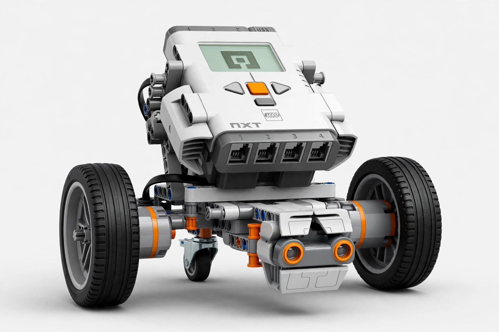
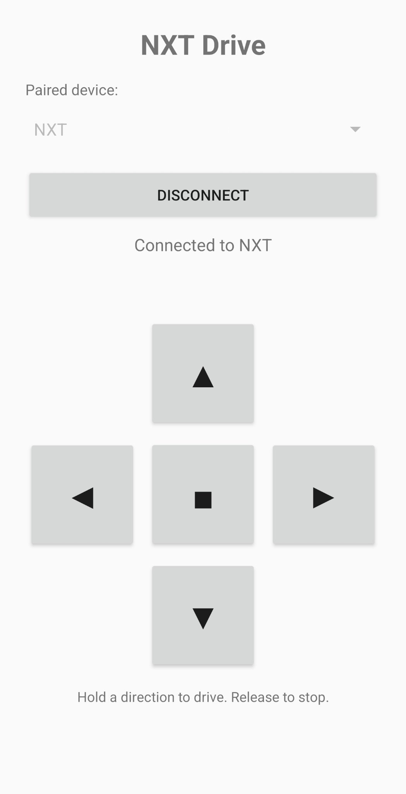

# NXT Drive

**Drive a LEGO MINDSTORMS NXT (2006) from an Android phone, over Bluetooth —
no legacy LEGO software anywhere in the loop.**

A second-hand NXT brick, a modern Android phone, and two small pieces of
code written for this project:

- **`app/`** — *NXT Drive*, a one-screen Android remote-control app
  (Bluetooth Classic SPP, hold-to-drive D-pad).
- **`brick/`** — *bt_drive*, an NXC program that runs on the brick's stock
  firmware and interprets one-letter commands arriving in mailbox 1.

Verified end-to-end on real hardware: a Samsung Galaxy S24 Ultra driving
an NXT brick (stock firmware 1.28) around the floor.

<p align="center">
  
  
</p>
<p align="center"><em>The robot, and the app that drives it — connected and ready.</em></p>

## How it works

```
┌──────────────┐   Bluetooth SPP    ┌──────────────────────────────┐
│  NXT Drive   │  ───────────────▶  │  bt_drive.rxe on the brick   │
│  (Android)   │  MessageWrite      │  mailbox 1:  F  B  L  R  S   │
└──────────────┘  telegrams         └──────────────────────────────┘
```

The app sends standard LEGO **MessageWrite** direct-command telegrams to
mailbox 1. The brick program latches each command — one tap keeps driving
until Stop — so the app is **hold-to-drive**: press an arrow to move,
release to stop. Two independent safety nets:

- Releasing any button (or closing the app / disconnecting) sends Stop.
- The brick program watches the Bluetooth link and **stops the motors
  itself if the link drops**.

| Button | Telegram (hex) | Letter | Brick does |
|---|---|---|---|
| ▲ Forward (hold) | `06 00 80 09 00 02 46 00` | F | both wheels forward |
| ▼ Backward (hold) | `06 00 80 09 00 02 42 00` | B | both wheels backward |
| ◀ Left (hold) | `06 00 80 09 00 02 4C 00` | L | spin left |
| ▶ Right (hold) | `06 00 80 09 00 02 52 00` | R | spin right |
| ■ Stop / release | `06 00 80 09 00 02 53 00` | S | stop |

Motor wiring assumed by `bt_drive`: **A = left wheel, B = right wheel**,
power 75. If your robot turns the wrong way, swap the A/B cables at the
brick (easiest) or swap the port definitions in `bt_drive.nxc`.

## Quick start

1. **Prepare the brick.** Upload `brick/bt_drive.rxe` over USB with any
   modern tool — e.g. [`nxt-python`](https://github.com/schodet/nxt-python):
   `nxt-push --backend usb bt_drive.rxe` — or compile `bt_drive.nxc`
   yourself with the NBC compiler and use `nbc -d -S=usb bt_drive.nxc`.
2. **Pair.** On the brick: Bluetooth **On** and **Visibility → Visible**.
   On the phone: pair from Android Settings, passkey **1234**.
3. **Run bt_drive on the brick** (My Files → Software files → bt_drive).
   It must be running before you drive: the firmware drops mailbox
   messages when no program is listening.
4. **Install the app** (sideload): build it (below) or grab `NXTDrive.apk`
   from this repo's Releases, copy it to the phone, open it, and allow
   "install unknown apps" when Android asks. It's debug-signed — that is
   expected outside the Play Store.
5. **Drive.** Open NXT Drive, grant the Bluetooth permission, pick the
   brick from the dropdown (already-paired devices only — the app does
   no discovery and asks for no location permission), Connect, and hold
   the arrows.

No app? See [`docs/terminal-app-alternative.md`](docs/terminal-app-alternative.md)
— any Bluetooth serial terminal with hex macros can send the same
telegrams.

## Building the app (no Gradle)

The build is hand-rolled in [`app/build.sh`](app/build.sh):
aapt2 compile/link → javac → d8 → zipalign → apksigner.

Requirements: **JDK 17** and the **Android SDK platform 34 +
build-tools 34.0.0** in `~/android-sdk` (override with `ANDROID_HOME=...`).

```bash
app/build.sh
# -> app/build/NXTDrive.apk  (debug-signed, signature verified by the script)
```

- Package `com.assix.nxtdrive`, min Android 8.0 (API 26), target API 34.
- Signing uses the standard debug keystore at `~/.android/debug.keystore`
  (created on first build), so rebuilt APKs install over the previous
  install without uninstalling.
- Permissions: Bluetooth only (`BLUETOOTH_CONNECT` on Android 12+,
  requested in-app).

## Building the brick program

`brick/bt_drive.rxe` is prebuilt and ready to upload. To rebuild from
source you need the NBC/NXC compiler (1.2.1) — on modern Linux,
`apt install nbc` or build it from source; the program targets the stock
firmware (no enhanced-firmware extensions).

```bash
nbc brick/bt_drive.nxc -O=brick/bt_drive.rxe
```

## Layout

```
app/     Android app: MainActivity.java, layout, manifest, build.sh
brick/   bt_drive.nxc (source) + bt_drive.rxe (prebuilt) for the NXT
docs/    driving bt_drive from a generic Bluetooth terminal app,
         plus images/ (robot picture and app screenshot)
```

## License

MIT — see [LICENSE](LICENSE). LEGO, MINDSTORMS and NXT are trademarks of
the LEGO Group, which does not sponsor or endorse this project.
